 

 

I build across the **browser, desktop, phone and terminal**: frontend performance, real-time 3D, native media apps and the occasional AI tool, with a software engineering and cybersecurity background. The scenes below are live animations of how each project looks and behaves. Click any of them to play it or read the source.

 

## ▍ Flagship

### 🏜️ [Endless Drive](https://project-magellan.pages.dev/)

An endless, procedurally generated world to **drive, sail and fly** through. The ATLAS is an off-road 4×4 that turns into a boat in deep water and unfolds into a plane on demand. Every visit grows a new world of meadows, pines, deserts, snowy ridges, lakes, rivers and inland seas, with a road network that follows the land, junctions, bridges, jump and barrel-roll ramps, day and night, rain and snow. Add `?seed=123456` to share a world.

   

<a href="https://project-magellan.pages.dev/"><b>▶ Play it</b></a> &nbsp;·&nbsp; <a href="https://github.com/hhaider3/project-magellan"><b>Source</b></a> &nbsp;·&nbsp; <a href="https://github.com/hhaider3/endless-drive-android/releases/latest"><b>Android app (up to 165 Hz)</b></a>

 

## ▍ Native apps

<table>
<tr>
<td width="50%" valign="top">

<h3>🎬 <a href="https://github.com/hhaider3/macmpv">macmpv</a></h3>

Native macOS player built on SwiftUI, mpv and FFmpeg. Hardware-accelerated playback, subtitles you can style, instant seek previews, a persistent queue and torrent streaming. <b>1.9</b> shows per-video download progress, plays saved torrents straight from disk and stops seeding once the queue is done.

   

<a href="https://macmpv.pages.dev/"><b>Website & downloads</b></a> &nbsp;·&nbsp; <a href="https://github.com/hhaider3/macmpv/releases/latest"><b>Latest release</b></a>

</td>
<td width="50%" valign="top">

<h3>🤖 <a href="https://github.com/hhaider3/andrompv">andrompv</a></h3>

macmpv rebuilt natively for Android: Jetpack Compose glass UI over real mpv/FFmpeg through JNI, native libtorrent streaming, double-tap seeking, swipe volume and brightness, picture-in-picture, background audio and in-app updates from GitHub releases.

   

<a href="https://github.com/hhaider3/andrompv/releases/latest"><b>Latest release</b></a> &nbsp;·&nbsp; <a href="https://github.com/hhaider3/andrompv"><b>Source</b></a>

</td>
</tr>
</table>

## ▍ Graphics &amp; real time

<table>
<tr>
<td width="50%" valign="top">

<h3>🛰️ <a href="https://github.com/hhaider3/live-sat-location">Earth Orbit Live</a></h3>

Interactive 3D satellite explorer: orbital paths, ground tracks, city pass predictions and honest data-freshness indicators, running at the edge on Cloudflare Workers.

   

<a href="https://live-sat-location.hasanhaider009.workers.dev/"><b>Open explorer</b></a> &nbsp;·&nbsp; <a href="https://github.com/hhaider3/live-sat-location"><b>Source</b></a>

</td>
<td width="50%" valign="top">

<h3>⚔️ <a href="https://github.com/hhaider3/motionlab">Motion Lab</a></h3>

Pair a phone by QR code and its motion sensors become a 3D sword on your screen. Slice blocks and feel the hit through phone vibration. Sensor data streams over WebSockets at about 60 Hz.

   

<a href="https://github.com/hhaider3/motionlab"><b>Source</b></a>

</td>
</tr>
</table>

## ▍ Games &amp; play

<table>
<tr>
<td width="50%" valign="top">

<h3>💥 <a href="https://github.com/hhaider3/terminalshooter">TERMINAL // BREACH</a></h3>

A five-wave arena FPS that runs entirely in your terminal: procedural renderer, enemy AI, shotgun combat and incremental ANSI output so it stays fast over SSH.

 

<a href="https://github.com/hhaider3/terminalshooter"><b>Source</b></a>

</td>
<td width="50%" valign="top">

<h3>♟️ <a href="https://github.com/hhaider3/stockfishonline">Stockfish Board</a></h3>

Browser chess against Stockfish with adjustable strength, live evaluation and analysis lines, all computed locally in your browser through WebAssembly.

   

<a href="https://site-creator-vinext-starter.hasanhaider009.workers.dev/"><b>Play chess</b></a> &nbsp;·&nbsp; <a href="https://github.com/hhaider3/stockfishonline"><b>Source</b></a>

</td>
</tr>
</table>

## ▍ More from the workshop

<table>
<tr>
<td width="50%" valign="top">

<h3>🖥️ <a href="https://hhaider3.github.io/">Desktop portfolio</a></h3>

My portfolio as a Windows 7 desktop in the browser: resizable app windows, a 3D globe, Motion Lab and my experience and projects.

  

<a href="https://hhaider3.github.io/"><b>Launch the desktop</b></a> &nbsp;·&nbsp; <a href="https://github.com/hhaider3/hhaider3.github.io/tree/source"><b>Source</b></a>

</td>
<td width="50%" valign="top">

<h3>📱 <a href="https://github.com/hhaider3/endless-drive-android">Endless Drive for Android</a></h3>

The driving game in a full-screen Android app whose only job is to ask the display for its fastest refresh rate. Chrome holds pages at 60 Hz on many phones; this runs up to 165 Hz.

  

<a href="https://github.com/hhaider3/endless-drive-android/releases/latest"><b>Download APK</b></a> &nbsp;·&nbsp; <a href="https://github.com/hhaider3/endless-drive-android"><b>Source</b></a>

</td>
</tr>
</table>

 

| Also | What it does |
| :--- | :--- |
| 📡 **[NearbyBluetooth](https://github.com/hhaider3/ble-scanner)** | React Native BLE discovery app with a stable device list and live RSSI tracking for nearby advertisers. |
| 🎓 **[Adaptive Personal Assistant](https://github.com/hhaider3/SER517_team5_industry)** | SER 517 team contributions to a Django tutoring app: learning goals, self-assessment, adaptive chat, understanding checks and related images. Python, MySQL, Ollama/OpenAI. |

<b>🗂️ Earlier work &amp; an open-source fork</b>

 

- **[GeoAnalysis Engineering website](https://github.com/hhaider3/newsite)**: React website with company information, services, publications and contact pages.
- **[Cloudflare Warp WireGuard Client](https://github.com/hhaider3/cloudflare-warp-wireguard-client)**: a fork of a Python utility for generating WireGuard profiles from Cloudflare Warp accounts. Original project by [ViRb3](https://github.com/ViRb3/cloudflare-warp-wireguard-client).

 

## ▍ Recently shipped

| When | What |
| :--- | :--- |
| **Oct 24** | **[Endless Drive for Android](https://github.com/hhaider3/endless-drive-android/releases/latest) v1.1**: 165 Hz on OnePlus, built to run the game above 60 fps. |
| **Oct 24** | **[Endless Drive](https://github.com/hhaider3/project-magellan)**: a road network with junctions, markings, wet and night looks, rivers and bridges, plus motion blur by default on phones. |
| **Oct 22** | **[macmpv 1.9](https://github.com/hhaider3/macmpv/releases/latest)** and **[andrompv v2.3.0](https://github.com/hhaider3/andrompv/releases/latest)**: torrents stop seeding when the queue is saved, the queue shows download progress, and saved videos play straight from disk. |
| **Oct 13** | **[andrompv](https://github.com/hhaider3/andrompv)** begins: macmpv, rebuilt natively for Android. |

 

## ▍ Toolbox

 
  

Also: SwiftUI · Jetpack Compose · React Native · WebSockets · Web Workers · WebAssembly · mpv · FFmpeg · libtorrent · Ollama

  

Questions, ideas or odd projects? <a href="https://www.linkedin.com/in/hasan-haider-52026a67/">Say hello on LinkedIn</a> or explore the <a href="https://hhaider3.github.io/">interactive portfolio</a>.

